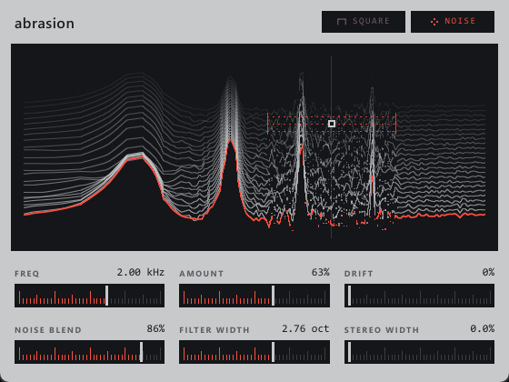

# abrasion

erosion style digital degradation vst3 written in rust with nih-plug and slint



a short delay gets modulated by a blend of a periodic carrier and band filtered noise. drag on the display to set freq and amount, hold alt to set the filter width instead, click the sine chip to switch between sine, triangle and square. drift adds a fast random wobble to the carrier

## build

```
cargo xtask bundle abrasion --release
```

the plugin ends up in `target/bundled/Abrasion.vst3`

for a quick look without a daw

```
ABR_DEMO=1 cargo run --release --features standalone -- -b dummy
```
